<div align="center">

<a href="https://anarqz.github.io/mkwmp/"></a>

<br>

<a href="https://anarqz.github.io/mkwmp/">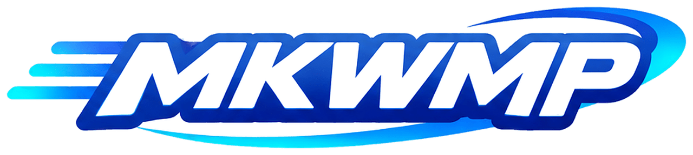</a>

### Race online. On your terms.

Community online servers, with a launcher to match: it sets the game up from your own copy,<br>
plays offline right away, and takes you online with friends, voice chat and mods.

<br>

[](https://github.com/anarqz/mkwmp/releases/latest)
[](https://github.com/anarqz/mkwmp/releases)
[](LICENSE)
[](https://github.com/anarqz/mkwmp/stargazers)

[](https://anarqz.github.io/mkwmp/)


**[Download](https://github.com/anarqz/mkwmp/releases/latest)** ·
**[Website](https://anarqz.github.io/mkwmp/)** ·
**[Host a server](https://anarqz.github.io/mkwmp/host.html)** ·
**[What's new](CHANGELOG.md)** ·
**[Report a bug](https://github.com/anarqz/mkwmp/issues/new/choose)**

</div>

> [!NOTE]
> MKWMP is an independent, open-source community project, not affiliated with or endorsed by the game's publisher. You need your **own copy of the game**. MKWMP ships none of the game's code or assets and never downloads the game. See [Interoperability and legal notes](docs/LEGAL.md).

<p align="center">
  <picture>
    <source media="(prefers-color-scheme: dark)" srcset="site/assets/launcher/home-dark.webp">
    <source media="(prefers-color-scheme: light)" srcset="site/assets/launcher/home-light.webp">
    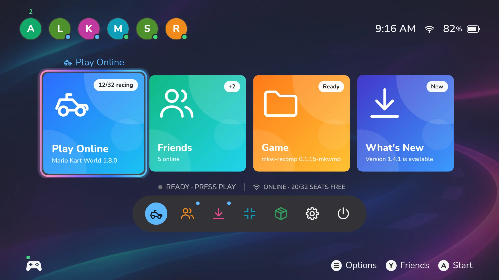
  </picture>
</p>

## Contents

- [Highlights](#highlights)
- [Get started](#get-started)
- [A tour of the launcher](#a-tour-of-the-launcher)
- [Host your own server](#host-your-own-server)
- [How it works](#how-it-works)
- [Build it yourself](#build-it-yourself)
- [Repository layout](#repository-layout)
- [Documentation](#documentation)
- [Reporting a bug](#reporting-a-bug)
- [Credits and license](#credits-and-license)

## Highlights

<table>
<tr>
<td width="33%" valign="top">
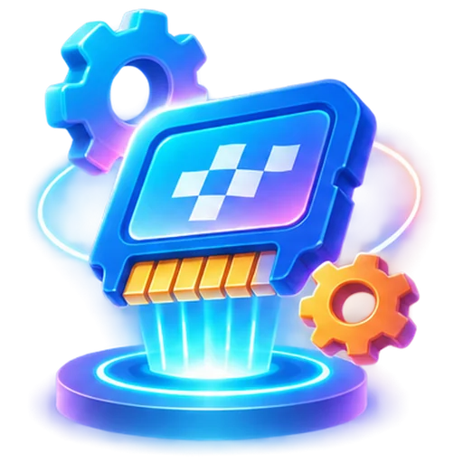<br>
<b>Set up in one go</b><br>
Point it at your copy of the game (.nup, .nx or a folder). The launcher downloads the official <a href="https://github.com/adriadam10/mkw-recomp">mkw-recomp</a>, builds the game from your copy and installs the MKWMP mod.
</td>
<td width="33%" valign="top">
<br>
<b>Offline first, online when you want</b><br>
Play right away with no account. To go online, pick a server, register a gamertag and keep your 6-digit PIN for other devices.
</td>
<td width="33%" valign="top">
<br>
<b>Community servers</b><br>
Anyone can host. Public servers list themselves in a live directory, and the launcher shows the nearest first.
</td>
</tr>
<tr>
<td valign="top">
<br>
<b>Friends, voice and camera</b><br>
Friend requests, who's online and who's racing. Voice chat and camera work only in private friend rooms, never with strangers in matchmaking.
</td>
<td valign="top">
<br>
<b>Mods, built in</b><br>
Browse GameBanana from the launcher, install with one button, and switch mods on and off. Saves are backed up before a new set of mods.
</td>
<td valign="top">
<br>
<b>Made for the couch</b><br>
A full-screen, console-style launcher for controller, keyboard or mouse, with an in-game overlay, light and dark themes, and 15 languages.
</td>
</tr>
<tr>
<td valign="top">
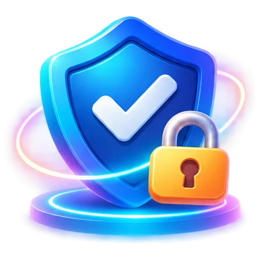<br>
<b>Private by design</b><br>
18+ only. A server keeps your gamertag, a PIN hash, your friends and any reports you file. Voice and camera are relayed live and never recorded.
</td>
<td valign="top">
<br>
<b>Signed updates</b><br>
The launcher and the mod update themselves from GitHub releases. Each download is checked against a signed <code>SHA256SUMS</code>.
</td>
<td valign="top">
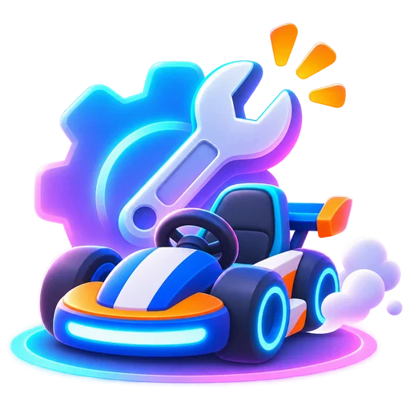<br>
<b>Crash reports that help</b><br>
After a crash, the launcher saves the logs (no PIN or keys) and opens a prefilled GitHub issue. Nothing is sent without you.
</td>
</tr>
</table>

## Get started

You need your own copy of the game, **version 1.8.0**, as a `.nup`, an `.nx` or a folder.

### Windows

1. Download **`mkwmp-<version>-windows-x64.zip`** from the [latest release](https://github.com/anarqz/mkwmp/releases/latest) and unzip it anywhere. It's portable: everything stays in that folder.
2. Open **`mkwmp.exe`**. The welcome asks for your language, a name and your copy of the game. It then sets up mkw-recomp (the first build takes a few minutes) and installs the MKWMP mod.
3. Press **Play**. Play offline, or choose **Go Online**, pick a server and register a gamertag.

### Steam Deck and SteamOS

In Desktop Mode, **close Steam**, open Konsole and run:

```sh
curl -fsSL https://anarqz.github.io/mkwmp/install.sh | bash
```

It installs MKWMP to `~/Games/MKWMP` and adds an **MKWMP** shortcut to Steam that runs under Proton, with artwork and a controller layout. Options such as `--dir`, `--proton`, `--dry-run` and `--uninstall` go after `bash -s --`. Details: [docs/LINUX.md](docs/LINUX.md).

<details>
<summary><b>Coming from 1.3?</b></summary>

1.4 is a new launcher (`mkwmp.exe`), and the 1.3 launcher can't update itself to it. Download 1.4 by hand once and unzip it over your 1.3 `mkwmp` folder. Your gamertag, PIN, server and game folder stay. Then delete the old `mkwmp-launcher.exe`. On a Steam Deck, run the install command above: it brings your 1.3 settings over and replaces the old shortcuts.
</details>

Step-by-step guides with pictures: **<https://anarqz.github.io/mkwmp/>**

## A tour of the launcher

<table>
<tr>
<td width="50%">
<picture>
  <source media="(prefers-color-scheme: light)" srcset="site/assets/launcher/welcome-play-online-light.webp">
  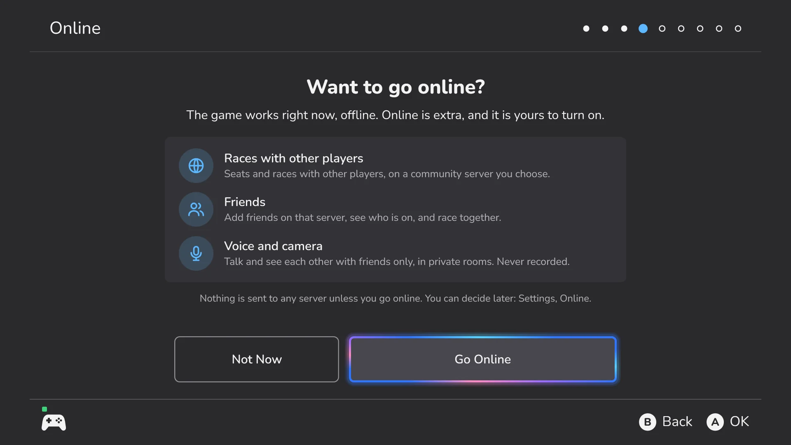
</picture>
<p align="center"><b>Offline first.</b> Going online is one choice away.</p>
</td>
<td width="50%">
<picture>
  <source media="(prefers-color-scheme: light)" srcset="site/assets/launcher/settings-online-light.webp">
  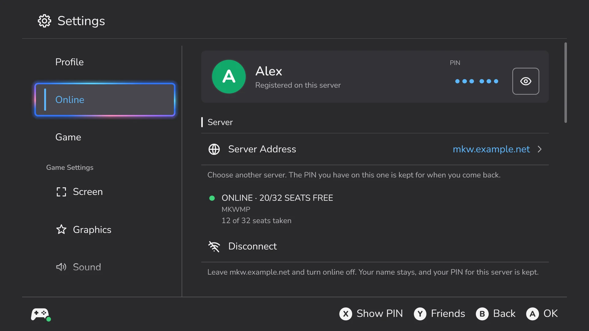
</picture>
<p align="center"><b>Servers.</b> A live list with region, players and latency.</p>
</td>
</tr>
<tr>
<td>
<picture>
  <source media="(prefers-color-scheme: light)" srcset="site/assets/launcher/home-friends-light.webp">
  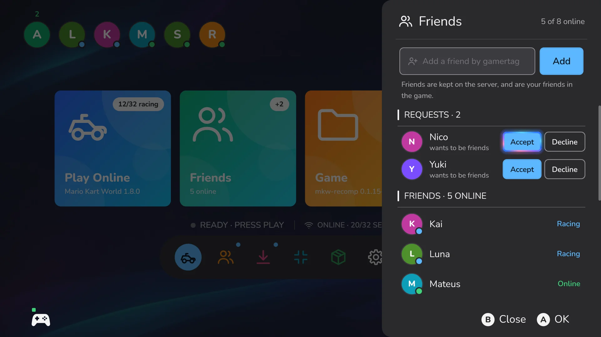
</picture>
<p align="center"><b>Friends.</b> Requests, who's online and who's racing.</p>
</td>
<td>
<picture>
  <source media="(prefers-color-scheme: light)" srcset="site/assets/launcher/overlay-light.webp">
  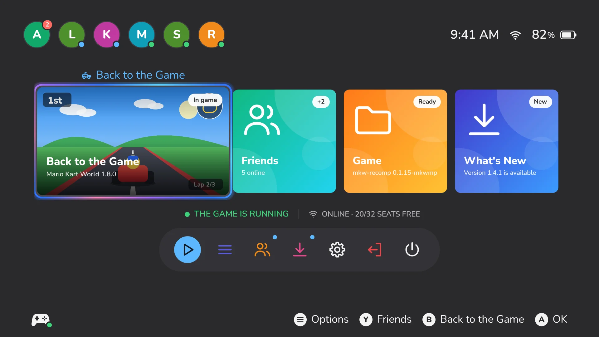
</picture>
<p align="center"><b>In-game overlay.</b> Guide or Select + Start pauses the game into Home.</p>
</td>
</tr>
<tr>
<td>
<picture>
  <source media="(prefers-color-scheme: light)" srcset="site/assets/launcher/mods-gamebanana-light.webp">
  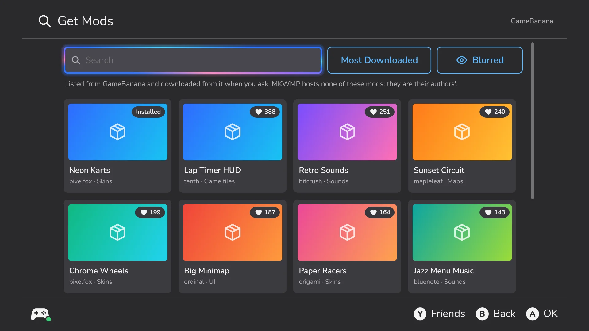
</picture>
<p align="center"><b>Mods.</b> Search GameBanana, or install from a link or a file.</p>
</td>
<td>
<picture>
  <source media="(prefers-color-scheme: light)" srcset="site/assets/launcher/settings-voice-light.webp">
  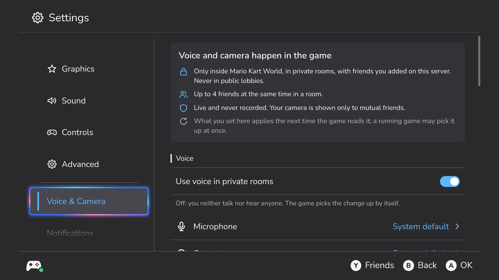
</picture>
<p align="center"><b>Voice and camera.</b> Pick and test your devices.</p>
</td>
</tr>
<tr>
<td>
<picture>
  <source media="(prefers-color-scheme: light)" srcset="site/assets/launcher/game-setup-progress-light.webp">
  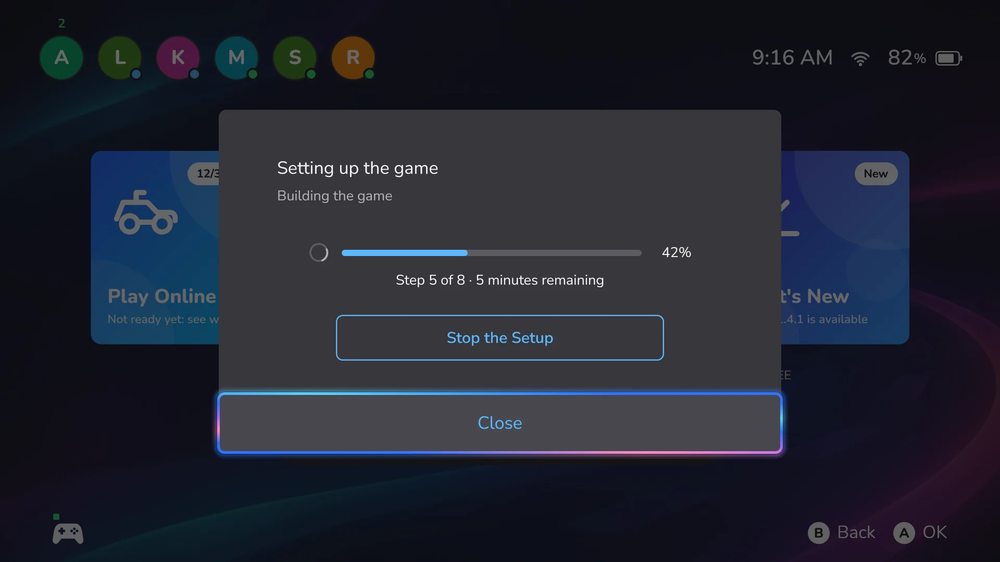
</picture>
<p align="center"><b>Game setup.</b> Built from your own copy, once.</p>
</td>
<td>
<picture>
  <source media="(prefers-color-scheme: light)" srcset="site/assets/launcher/deck-home-light.webp">
  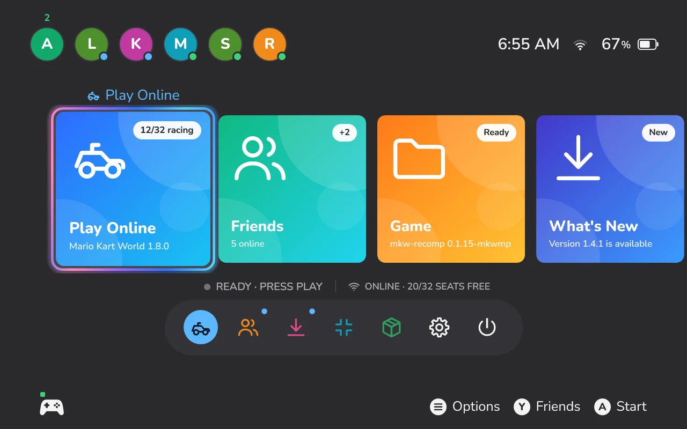
</picture>
<p align="center"><b>Steam Deck.</b> The same launcher at 1280 × 800.</p>
</td>
</tr>
</table>

## Host your own server

<p align="center">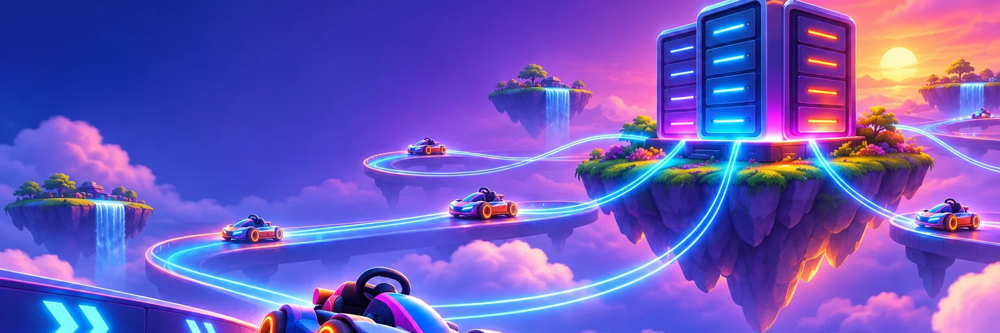</p>

The whole server is one program, **`server`** (`server.exe` on Windows), in the release's `mkwmp-server-<version>.zip`. It runs gamertags, friends, seats and the game lobby, and it sets itself up on the first run.

| Where | How | Good for |
| --- | --- | --- |
| **A cloud VM** (Vultr, Ubuntu 24.04, about US$5 a month) | `curl -fsSL https://anarqz.github.io/mkwmp/deploy-mkwmp-server.sh \| sudo bash` | a public server for dozens of players, listed in everyone's launcher; optional HTTPS with `--domain` |
| **Your own PC** (Windows or Linux) | unzip `mkwmp-server-<version>.zip`, run `server.exe` (or `./server`) | friends and LAN parties |
| **Docker Compose** (any Linux host) | `cp .env.example .env` (set `MKWMP_PUBLIC_IP`), then `docker compose up -d --build` | your own VM or home server |

The cloud script checks the download against the release's signed checksums, installs two systemd services (`mkwmp-seat` and `mkwmp-lobby`), opens the firewall, writes a privacy policy template for you to edit, and lists the server in the public directory (`--no-announce` keeps it out). Follow the **[step-by-step guide](https://anarqz.github.io/mkwmp/host.html)**.

**Ports to open:**

| Port | Protocol | Used by |
| --- | --- | --- |
| 7000 | TCP | the launcher: gamertags, friends, seats (80/443 instead with a domain) |
| 8905, 8906 | TCP | the game: sign-in, matchmaking, sessions, Gamesync |
| 3478, 10025 | UDP | the game: TURN relay and NAT check |
| 8907 | UDP | voice chat and camera relay (friend rooms) |
| 49152–49407 | UDP | relayed race traffic |

<details>
<summary><b>Day-to-day admin</b></summary>

```sh
server host --public-ip 203.0.113.7 --name "Friday kart" --capacity 12   # change settings (they're saved)
server admin list            --config mkwmp-data/server.toml             # gamertags
server admin register <name> --config mkwmp-data/server.toml             # reserve a name and get its PIN
server admin reset-pin <name> --config mkwmp-data/server.toml            # forgotten PIN: a new one (old PINs can't be recovered)
server admin reports         --config mkwmp-data/server.toml             # voice and camera abuse reports
```

- **Back up** `mkwmp-data` while the server is stopped, and keep it private: it holds your server's keys.
- **Update** by replacing the program with the newer release and starting it again.
- For an internet-facing server, put HTTPS in front of port 7000 (the script's `--domain`, the Docker `https` profile, or your own proxy): over plain `http://`, PINs cross the network unencrypted.
</details>

Everything else, including running the two parts separately under systemd and troubleshooting, is in **[docs/HOSTING.md](docs/HOSTING.md)**.

## How it works

```
 player PC                                         MKWMP server (anyone can host one)
┌───────────────────────────────┐   seat API (HTTP/S)   ┌──────────────────────────────────────┐
│ mkwmp.exe   the launcher      │ ────────────────────► │ server seat                          │
│  gamertag + PIN, friends,     │ ◄── queue / ticket ── │  gamertags, PIN hashes, friends,     │
│  server list, mods, updates   │                       │  seats + queue, signed tickets       │
│                               │                       │  (SQLite registry)                   │
│ mkw-recomp + the MKWMP mod    │                       │        ▲ roster (localhost)          │
│  game services ───────────────┼── gRPC over TLS ─────►│ server lobby                         │
│  race traffic ◄───────────────┼── Pia UDP / TURN ────►│  matchmaking, sessions, referee,     │
│  voice + camera ◄─────────────┼── relay (UDP) ───────►│  friend rooms, TURN, voice relay     │
└───────────────────────────────┘                       └──────────────────────────────────────┘
                                                               │ announce
                                                               ▼
                                                  server directory (beholder): the live list
```

- The **launcher** takes a seat on the server you picked (or waits in its queue) and hands the game a ticket signed with the server's Ed25519 key.
- The **MKWMP mod**, loaded by mkw-recomp, points the game's online services at that server's lobby and trusts the lobby's own certificate. It doesn't modify the game's files.
- The **lobby** is a from-scratch reimplementation of the online services the game expects: sign-in, matchmaking across any number of lobbies, sessions, match results, friend rooms, and a TURN relay for players who can't reach each other directly.
- **Beholder** is the server directory: public servers announce themselves, and the launcher and the website list them.

The full picture: [docs/ARCHITECTURE.md](docs/ARCHITECTURE.md).

## Build it yourself

Everything builds from this repository. Releases are built by hand from the same sources and signed; no release is built by CI.

| Part | Needs |
| --- | --- |
| Server (`rust/`) | [Rust](https://rustup.rs) stable. The protobuf compiler is vendored. [cargo-zigbuild](https://github.com/rust-cross/cargo-zigbuild) for cross builds |
| Launcher (`launcher/`) | Windows with the [.NET 10 SDK](https://dotnet.microsoft.com/download) (10.0.401+); Visual Studio's C++ x64 tools for the Native AOT update helper |
| MKWMP mod (`native/`) | [Zig](https://ziglang.org) 0.15 and Python 3 |

**Server**

```sh
cargo build --release --manifest-path rust/Cargo.toml -p mkwmp
# -> rust/target/release/server   (host | seat | lobby | beholder | keygen | admin)

# static Linux binary for a VM, from macOS or Linux:
cargo zigbuild --release --manifest-path rust/Cargo.toml -p mkwmp --target x86_64-unknown-linux-musl

# or the Docker image:
docker compose build
```

**Launcher** (PowerShell, on Windows)

```powershell
.\launcher\run.ps1 --demo                              # build and run with demo data
.\launcher\publish.ps1 -Out C:\tmp\mkwmp -Dev          # the release layout, with an unsigned dev build of the mod
.\launcher\publish.ps1 -Out C:\tmp\mkwmp -NoGame       # the launcher only (no Zig or Python needed)
```

A `-Dev` build is for testing only: the launcher accepts its unsigned `game\` folder and says so in Settings › Game.

**MKWMP mod**

```sh
python native/probe/build_plugin.py --target all --package   # -> native/probe/build/plugin/mkwmp-mod.zip
```

`--zig PATH` picks the Zig binary. `native/voice` and `native/camera` build the voice and camera libraries the mod packs when they're present.

**Tests**

```sh
cargo test --manifest-path rust/Cargo.toml --workspace   # server: includes end-to-end runs of the real binary
dotnet test launcher/tests/Mkwmp.Core.Tests              # launcher core
```

## Repository layout

| Path | What's there |
| --- | --- |
| [`launcher/`](launcher) | the launcher (C#, WPF, .NET 10): `Mkwmp.App` (UI), `Mkwmp.Core`, `Mkwmp.Update` and `Mkwmp.Updater` (signed self-update) |
| [`rust/mkwmp`](rust/mkwmp) | the server binary `server`: `host`, `seat`, `lobby`, `beholder`, `keygen`, `admin` |
| [`rust/seat`](rust/seat) | seat server: gamertags and PINs (SQLite), friends, presence, seats, queue, signed tickets, reports |
| [`rust/lobby`](rust/lobby) | game-facing lobby logic: matchmaking, sessions, referee, friend rooms |
| [`rust/gateway`](rust/gateway) | gRPC over HTTP/2 + TLS, TURN relay, NAT responder, voice and camera relay, rate limits |
| [`rust/beholder`](rust/beholder) | the public server directory |
| `rust/{config,contracts,ticket}` | server config, generated protocol types, ticket signing |
| `rust/client` | the earlier Rust launcher (1.3 and before) |
| [`native/`](native) | the MKWMP mod for mkw-recomp (`probe`), and the voice and camera libraries |
| [`contracts/`](contracts) | the protocol definitions (`.proto`) MKWMP's server speaks |
| [`config/`](config) | example `server.toml` and `client.toml` |
| `compose.yaml`, [`deploy/`](deploy) | Docker Compose stack, Dockerfile, Caddy, systemd units |
| [`site/`](site) | the website, published with GitHub Pages; built by `tools/site/build.py` |
| [`tools/`](tools) | release scripts, the Steam Deck installer, mkw-recomp checks, site builder |
| [`docs/`](docs) | guides and API contracts (below) |
| `resources/` | the original Python reference lobby and older prototypes |

## Documentation

| Guide | |
| --- | --- |
| [HOSTING.md](docs/HOSTING.md) | every way to run a server: cloud VM, your PC, Docker, systemd by hand |
| [LINUX.md](docs/LINUX.md) | SteamOS and Linux: the installer, Proton, launch options |
| [ARCHITECTURE.md](docs/ARCHITECTURE.md) | how the launcher, the mod, the seat server and the lobby fit together |
| [LEGAL.md](docs/LEGAL.md) | interoperability notes: what MKWMP contains and doesn't do |
| [contracts/](docs/contracts) | [seat API](docs/contracts/SEAT_API.md), [launcher API](docs/contracts/LAUNCHER_API.md), [voice](docs/contracts/VOICE_API.md), [video](docs/contracts/VIDEO_API.md), [beholder](docs/contracts/BEHOLDER_API.md) |
| [launcher/docs/](launcher/docs) | launcher design, overlay, mods, updates, mkw-recomp integration |
| [CHANGELOG.md](CHANGELOG.md) | what changed in each release (also the launcher's What's New page) |

## Reporting a bug

Open an [issue](https://github.com/anarqz/mkwmp/issues/new/choose) and fill in the form. After a crash, the launcher offers **Report**: it saves a zip of the details and logs on your Desktop (your PIN and keys are left out) and opens a prefilled issue. **Found a bug?** in the launcher does the same at any time. Drag the zip into the issue.

Requests that help obtain or copy games, keys or firmware, unlock paid content or cheat against other players are out of scope ([LEGAL.md](docs/LEGAL.md#out-of-scope)).

## Credits and license

- Built on **[mkw-recomp](https://github.com/adriadam10/mkw-recomp)**, a static recompilation of the game by [Adrià](https://github.com/adriadam10), released under the MIT License. MKWMP installs the official release.
- Third-party components and their licenses: [NOTICE.md](NOTICE.md). The art in this repository is MKWMP's own.

MKWMP is free software under the **GNU General Public License, version 3 or later**. See [LICENSE](LICENSE).

<p align="center"><a href="https://anarqz.github.io/mkwmp/"></a></p>
