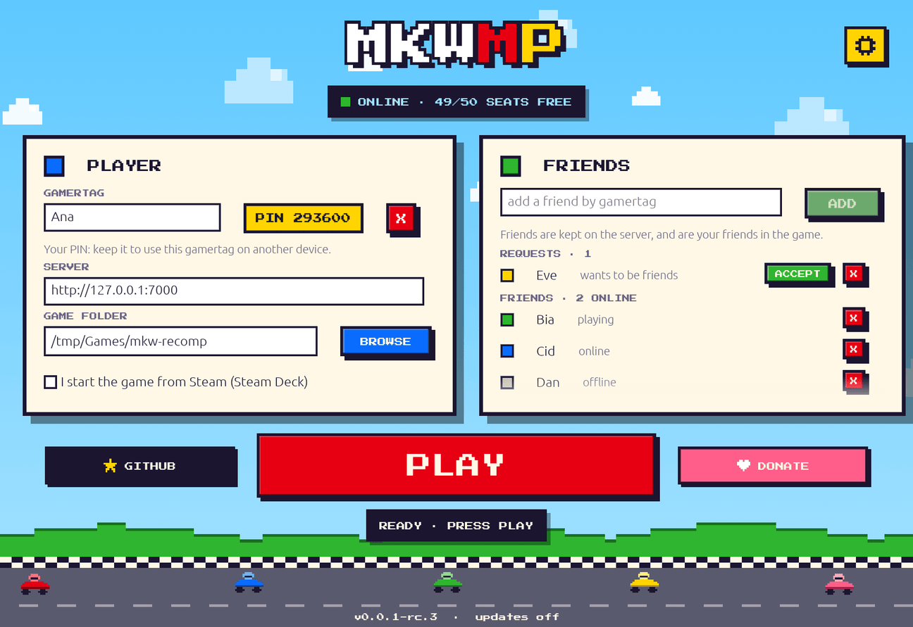
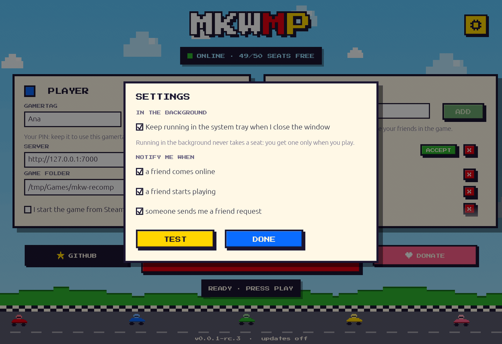

# MKWMP

Community online play for the [mkw-recomp](https://github.com/adriadam10/mkw-recomp) PC runtime: gamertags, friends, and race and battle lobbies on servers anyone can host.

**Website and setup guides: <https://anarqz.github.io/mkwmp/>**

> MKWMP is an unofficial community project, not affiliated with or endorsed by Nintendo. You need your own copy of the game.
>
> **Status: developer preview** ([v0.0.1-rc.3](https://github.com/anarqz/mkwmp/releases)). Online races and battles work end to end. The new lobby server, friend rooms and self-hosted servers with the real game are being tested.



## What it does

- **Gamertags.** Register one in the launcher and get a 6-digit PIN, which lets you use the same gamertag on another PC or a Steam Deck.
- **Friends, kept on the server.** Add friends by gamertag; they accept or decline. You see who is playing, online or offline, and they're your friends in the game too.
- **Matchmaking with any number of lobbies.** Races and battles open new lobbies as players arrive and close them when they empty.
- **Seats and a queue.** Each server has a fixed number of seats. PLAY takes one, or puts you in line. Having the launcher open doesn't take a seat.
- **Background mode.** Close the launcher and it stays in the system tray, with notifications when a friend comes online, starts playing or sends you a request.
- **Signed updates.** The launcher updates itself and the game patch from GitHub releases, and checks each download against the release signature.
- **Host your own** on a PC with one program, or on a Linux server with Docker Compose.



## Play

1. Set up **mkw-recomp 0.1.10** (Windows build) with your own copy of the game, version 1.0.0. On a Steam Deck, run it through Proton 10.0.
2. Download the launcher for your system from the [latest release](https://github.com/anarqz/mkwmp/releases):
   - `mkwmp-launcher-x86_64-windows.exe` for Windows;
   - `mkwmp-launcher-x86_64-linux` for SteamOS and Linux.
3. Open it, register a gamertag, pick the game folder and press **PLAY**. The first run installs the game patch (`winmm.dll`).

Step-by-step guides for Windows and the Steam Deck: <https://anarqz.github.io/mkwmp/>.

## Host your own server

> **Needs rc.2 or later**, for the server and for every player. The rc.2 launcher and game patch trust each server's own certificate; rc.1 can only reach the official server. Launchers update themselves when you press PLAY. Self-hosted servers have been tested end to end without the real game; the first real-game runs are coming.

The whole server is one program, `mkwmp-server`. It runs gamertags, friends, seats and the game lobby, and it sets itself up on the first run. A normal PC is enough to host your friends.

### What you need

- **A computer that stays on while you play.** Windows or Linux; 1 CPU core and 1 GB of memory are plenty. It can be one of the players' own PCs.
- **For a LAN party:** nothing else.
- **For friends over the internet:**
  - a router where you can set up **port forwarding**;
  - a **public IPv4 address**. Some internet providers share one address between customers (CGNAT). If the WAN address in your router's status page differs from the one "what is my IP" shows, you're behind CGNAT and can't host from home. Rent a small Linux VM instead, as in [Docker](#on-a-linux-server-with-docker) below.

### 1. Start the server

- **Windows:** download `mkwmp-server-x86_64-windows.exe` from the [releases](https://github.com/anarqz/mkwmp/releases) and put it in a folder of its own. Double-click it.
- **Linux:** download `mkwmp-server-x86_64-linux`, then run `chmod +x mkwmp-server-x86_64-linux` and `./mkwmp-server-x86_64-linux`.

On the first run it asks one question: **which address do players reach this machine at?**
- **LAN party:** press Enter to accept the suggested LAN address, e.g. `192.168.1.20`.
- **Over the internet:** type your public IP (search "what is my IP").

It then creates a `mkwmp-data` folder next to itself and starts:

```
created the ticket signing key
created the lobby certificate
data folder: C:\Games\mkwmp-server\mkwmp-data
players set the launcher's SERVER to: http://203.0.113.7:7000
open (and on a home router, forward to this machine): TCP 7000, 8905, 8906; UDP 3478, 10025, 49152-49407
running; stop with Ctrl-C or by closing this window (players' seats are freed, gamertags are kept)
```

Keep that window open while you play. Next time, just start it again: it remembers its settings.

### 2. Open the ports

| Port | Protocol | Used by |
| --- | --- | --- |
| 7000 | TCP | the launcher: gamertags, friends, seats |
| 8905, 8906 | TCP | the game: sign-in, matchmaking, sessions |
| 3478, 10025 | UDP | the game: relay and connection check |
| 49152–49407 | UDP | the game: relayed race traffic |

- **Windows firewall:** when Windows asks whether to allow `mkwmp-server`, allow it. If you missed the prompt, run this in an administrator terminal:
  `netsh advfirewall firewall add rule name="mkwmp-server" dir=in action=allow program="<full path to mkwmp-server-x86_64-windows.exe>"`
- **Linux firewall** (ufw): `sudo ufw allow 7000,8905,8906/tcp && sudo ufw allow 3478,10025/udp && sudo ufw allow 49152:49407/udp`.
- **Router (internet only):** forward every port in the table to the hosting PC's LAN address. Give that PC a fixed LAN address (a DHCP reservation) so the forwarding keeps working.

### 3. Players join

Each player, including you, does three things in the launcher:
1. Set **SERVER** to `http://<the address you entered>:7000`. The status bar shows your server's seats once it's reachable.
2. Register a gamertag. Gamertags and friends belong to each server, so everyone registers again on yours, and friends are added again too.
3. Press **PLAY**, and in the game pick Online Play → Race or Battle.

### Day to day

- **Change settings:** start it from a terminal with flags; they're saved for next time:
  `mkwmp-server host --public-ip 203.0.113.7 --name "Friday kart" --capacity 12`
  Other options: `--turn-port`, `--seat-bind`, `--data`. Run `mkwmp-server host --help` for the list.
- **Forgotten PIN, reserved names:** run these on the hosting machine while the server runs:
  `mkwmp-server admin reset-pin <gamertag> --config mkwmp-data/server.toml`. The other commands are `list`, `register <name>` (reserve it and get its PIN) and `release <name>`.
- **Back up** the `mkwmp-data` folder while the server is stopped. Keep it private: it holds your server's keys.
- **Update:** replace the program with the newer release and start it again. `mkwmp-data` stays.

### If something doesn't work

- **The launcher shows the server as offline:** check that the address is right, that TCP 7000 is open (and forwarded), and that the server window is running.
- **The game says it can't connect after PLAY:** TCP 8905/8906 are blocked, or the player is still on rc.1.
- **Players reach the lobby but races fail to start:** the UDP ports (3478, 10025, 49152–49407) are blocked or not forwarded.
- **Your public IP changed:** start once with `--public-ip <new address>`. Players update SERVER in their launcher, unless it uses a dynamic-DNS name (`http://myname.ddns.net:7000` works there). The server itself always needs the raw IP, because that is what it hands to the game.

### On a Linux server with Docker

The same server runs in Docker, which suits a VM:

```sh
git clone https://github.com/anarqz/mkwmp && cd mkwmp
cp .env.example .env              # set MKWMP_PUBLIC_IP (name, seats and ports are optional)
docker compose up -d --build
```

It needs a Linux host: on Docker Desktop for Windows or macOS, the lobby can't see players' real addresses, so use the program above there. With a domain, `docker compose --profile https up -d` adds HTTPS, and players then use `https://<domain>`.

### Security

- The launcher talks to your server over plain `http://`, so gamertag PINs cross the network unencrypted. That's fine on a LAN. For a server open to the internet, put HTTPS in front of port 7000, with the Docker `https` profile or your own reverse proxy.
- Never share `mkwmp-data`: anyone with its keys can impersonate your server.

More detail, including running the two parts separately under systemd: [docs/HOSTING.md](docs/HOSTING.md).

## Build it yourself

Everything builds from this repository. Releases are built by hand from the same sources; nothing is built by CI.

### Requirements

- **Rust** (stable): <https://rustup.rs>. The protobuf compiler is vendored, so there's nothing else to install.
- **Game patch:** [zig](https://ziglang.org) 0.15 and Python 3.
- **Cross-building** (optional): [cargo-zigbuild](https://github.com/rust-cross/cargo-zigbuild) builds the Windows launcher and a static Linux server from macOS or Linux.

### Launcher

```sh
cargo build --release --manifest-path rust/Cargo.toml -p client
# -> rust/target/release/mkwmp-launcher(.exe)

# Windows build from macOS/Linux:
cargo zigbuild --release --manifest-path rust/Cargo.toml -p client --target x86_64-pc-windows-gnu
```

A launcher you build yourself still updates itself from GitHub releases. To keep your build, turn updates off by setting `update = false` in its `client.toml`.

### Server

```sh
cargo build --release --manifest-path rust/Cargo.toml -p mkwmp
# -> rust/target/release/mkwmp   (mkwmp host | server | lobby | keygen | admin)

# Static Linux binary for a VM:
cargo zigbuild --release --manifest-path rust/Cargo.toml -p mkwmp --target x86_64-unknown-linux-musl
```

The Docker image builds the same binary: `docker compose build`.

### Game patch (`winmm.dll`)

```sh
python native/probe/build.py --version dev                         # -> native/probe/build/winmm.dll
python native/probe/build.py --install "C:\Games\mkw-recomp"       # build and copy into the game folder
```

`--zig PATH` selects the zig binary; the default is `zig` on your PATH.

### Tests

```sh
cargo test --manifest-path rust/Cargo.toml --workspace
```

Two tests start the real `mkwmp` binary. One plays two clients from sign-in to a shared session (TLS, Gamesync, NAT, TURN); the other covers seat expiry through the roster.

## Repository layout

| Path | What's there |
| --- | --- |
| `rust/client` | the launcher (egui): gamertag, friends, seats, tray, self-update |
| `rust/seat` | seat server: gamertags and PINs (SQLite), friends, presence, seats, queue, signed tickets |
| `rust/lobby` | the game-facing lobby logic: matchmaking, sessions, referee, friend rooms |
| `rust/gateway` | gRPC over HTTP/2 + TLS, TURN relay, NAT responder, rate limits |
| `rust/mkwmp` | the server binary: `mkwmp host` (everything, set up on first run), `server`, `lobby`, `keygen`, `admin` |
| `rust/{config,contracts,ticket}` | server config, NPLN protobuf types, seat ticket signing |
| `native/probe` | the game patch (`winmm.dll`): redirects the game's online services to an mkwmp server |
| `contracts/` | the game's NPLN service definitions (`.proto`) |
| `config/` | example configs: `server.toml` (the server), `client.toml` (the launcher) |
| `compose.yaml`, `deploy/` | Docker Compose stack, Dockerfile, systemd units |
| `docs/` | [HOSTING](docs/HOSTING.md), [ARCHITECTURE](docs/ARCHITECTURE.md), [seat API](docs/contracts/SEAT_API.md), [launcher API](docs/contracts/LAUNCHER_API.md) |
| `site/` | the website (GitHub Pages) |
| `tools/` | release script (`tools/release`) and a local seat server helper (`tools/host`) |
| `resources/` | research material: reverse-engineering notes and tools, captures, the original Python lobby, handoff notes |

## Support

MKWMP is made by players, for players. If you'd like to help keep the official server running: [Ko-fi](https://ko-fi.com/anarqz).
